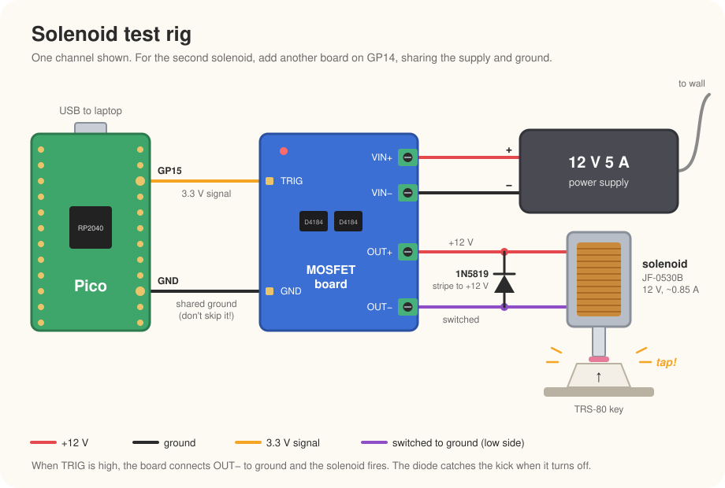

# Solenoid test rig

The first hardware test: a Raspberry Pi Pico fires one or two solenoids
through MOSFET boards. The goals are to confirm the solenoid presses a Model I
key reliably, to tune the pulse length and holding duty, and later to measure
the round-trip latency with the camera.

<p align="center">
  <picture>
    <source media="(prefers-color-scheme: dark)" srcset="images/solenoid-circuit-dark.svg">
    
  </picture>
</p>

## Parts

Details and links are in [PARTS.md](../PARTS.md).

| Part | Qty |
|---|---|
| Raspberry Pi Pico | 1 |
| JF-0530B solenoid, 12 V ~0.85 A | 2 |
| Dual MOSFET trigger switch board (D4184) | 1 per solenoid |
| 1N5819 Schottky diode | 1 per solenoid |
| 12 V 5 A power supply, with barrel-to-screw-terminal adapter | 1 |

## Wiring

For each solenoid:

1. 12 V supply + and − to the board's **VIN+** and **VIN−**.
2. Solenoid to **OUT+** and **OUT−**. Its polarity doesn't matter.
3. Diode across the solenoid, **stripe to OUT+** (+12 V). Backwards, it shorts
   the supply as soon as the board turns on.
4. Pico GPIO to **TRIG**: GP15 for the first solenoid, GP14 for the second.
5. Pico **GND** to the board's **GND**. Without a shared ground the trigger
   doesn't work.

The board is a low-side switch: OUT+ is always at +12 V, and TRIG high connects
OUT− to ground. The MOSFET's built-in body diode doesn't protect it from the
turn-off spike, which is why the external diode is needed.

## First test (MicroPython)

Start with short pulses:

```python
from machine import Pin
import time

sol = Pin(15, Pin.OUT, value=0)
for _ in range(10):
    sol.on()
    time.sleep_ms(40)
    sol.off()
    time.sleep_ms(500)
```

Then try peak-and-hold, which keeps a held key from overheating the solenoid:

```python
from machine import Pin, PWM
import time

pwm = PWM(Pin(15), freq=1000, duty_u16=0)
pwm.duty_u16(65535)   # full power to pull the plunger in
time.sleep_ms(20)
pwm.duty_u16(20000)   # ~30% to hold; tune down until the key slips
time.sleep(2)
pwm.duty_u16(0)
```

## Things to check

- **Nothing fires at boot.** The Pico's GPIOs start with a weak pull-down. If
  the solenoid twitches at power-up or reset, add a 10 kΩ resistor from TRIG to
  GND.
- **The MOSFET turns fully on.** A reviewer measured the board's trigger
  switching at about 3 V, close to the Pico's 3.3 V. With the solenoid held
  on, the voltage across the solenoid should be nearly the full 12 V, and the
  board should stay cool. If not, put a 5 V buffer (e.g. 74AHCT125) between the
  Pico and TRIG.
- **The key registers.** The game has to see the key for at least one scan, so
  30–50 ms is the floor. Find the shortest pulse that registers every time on
  both Alps and Hi-Tek keyboards.
- **Heat.** Held at full power, the solenoid dissipates about 10 W. Feel it
  after a few seconds of holding, with and without peak-and-hold.
- **Release time.** With a plain diode, the coil current fades slowly, so the
  plunger lets go a few milliseconds late. If that shows up in the latency
  measurements, a ~18 V Zener in series with the 1N5819 speeds it up.
